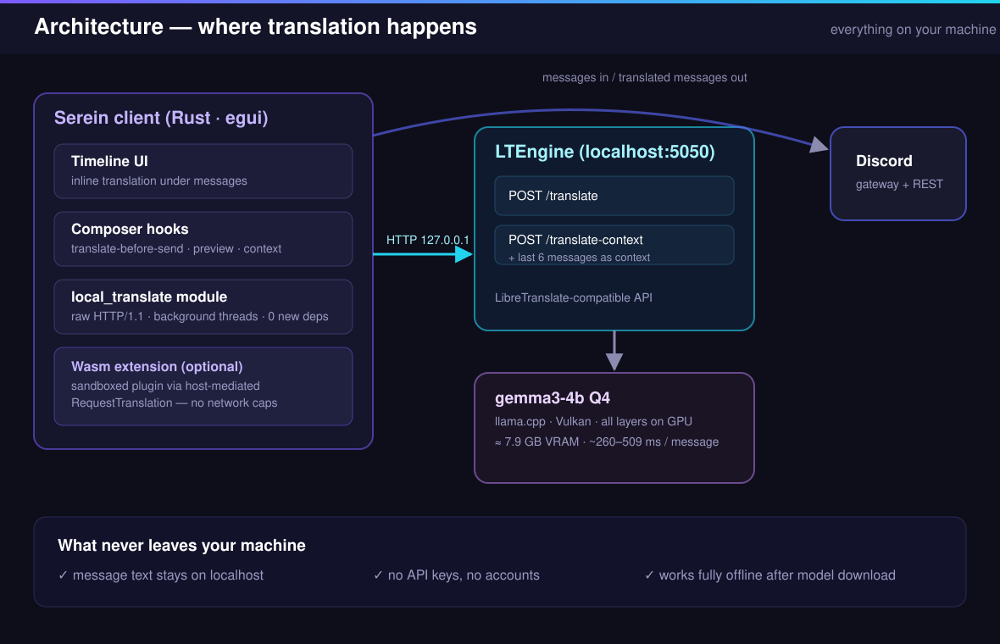

<p align="center">
  
</p>

# Serein Translate

[](https://github.com/neckttiie090520/Serein-AI-Translate-Extension/actions/workflows/ci.yml)
[](#credits--license)
[](docs/platform-support.md)

**On-device LLM translation for the Serein Discord client.** Inline translations under any message, auto-translate for incoming traffic, preview-confirmed translation before you hit send — and an optional conversation-context mode that resolves pronouns and names from the last messages in the channel. All inference runs on your own GPU through a local [LTEngine](https://github.com/LibreTranslate/LibreTranslate) server. **Zero cloud APIs, zero API keys, zero telemetry.**

> Forked from [ViceVerse-cz/Serein](https://github.com/ViceVerse-cz/Serein) — a native Rust Discord client. This repo carries the translation layer; everything else is upstream.

---

## Why

Every Discord translation plugin today (Vencord Translate & friends) ships your messages to Google, DeepL or Kagi. That means API keys, rate limits, accounts, and your conversations on someone else's server. Serein Translate is the first client-integrated translation that never leaves the machine: a 4B model quantized to 4 bits runs entirely on a consumer GPU and answers in a fraction of a second.

| | **Serein Translate** | Vencord Translate |
|---|---|---|
| Where inference runs | your GPU (localhost) | Google / DeepL / Kagi cloud |
| API key needed | none | yes (per service) |
| Inline translation under messages | ✅ full markdown | ✅ |
| Auto-translate incoming | ✅ with same-language skip | ✅ |
| Translate before sending | ✅ direct **or preview-confirmed** | ✅ (no preview) |
| Conversation-context translation | ✅ last 6 messages resolve pronouns/names | ❌ |
| Extension API for plugins | ✅ host-mediated `RequestTranslation` | — (userscript) |
| Privacy | text never leaves `127.0.0.1` | text leaves the machine |
| Cost | free, offline-capable | metered / account-bound |

## Features

- **Inline translation** — click ⇄ on any message; the translation renders under it through the full markdown pipeline, with a *Translated from {language}* caption and a one-click hide in the hover toolbar.
- **Auto-translate incoming** — new messages translate themselves. Messages already in your target language are detected and skipped silently.
- **Translate before sending** — two modes: send immediately, or get a **preview card** above the composer with *Send translation* / *Keep original draft*.
- **Context-aware mode** — the last 6 channel messages are passed along, so the model resolves *"เจอกันพรุ่งนี้นะ"* vs *"see you there"* correctly based on who said what. Toggle it on when nuance matters; off when speed does.
- **Settings window in the chat bar** — target languages, incoming/outgoing toggles, preview and context switches, live service indicator.
- **Sandboxed extension API** — plugins can request translations through a validated host-mediated action; the Wasm sandbox keeps its no-network guarantee.


## Performance

Measured on RTX 5060 (8 GB, Vulkan) · gemma3-4b Q4_K_M, all 34 layers on GPU · Ryzen 7800X3D:

| Message type | Latency |
|---|---|
| Short chat (≤ 10 words) | **259–349 ms** |
| Medium technical | ~509 ms |
| Long paragraph (TH→EN) | ~3.1 s |
| Context-aware (6 messages ctx) | ~1.5–2× base |

Quality holds across TH↔EN, JP→EN; internet slang is the known weak spot of a 4B model.

## Architecture



1. **Serein** (this fork) renders chat and hosts `local_translate` — raw HTTP/1.1 over a background thread pool, no new dependencies added to the UI crate.
2. **LTEngine** (separate process, LibreTranslate's Rust llama.cpp server) exposes `/translate` and `/translate-context` on `127.0.0.1:5050`.
3. **gemma3-4b** runs on your GPU via Vulkan. Nothing — not one byte of message text — ever leaves localhost.

## Getting started

### 1. Run the translation engine

```bash
# LTEngine — LibreTranslate's llama.cpp server (Vulkan build)
git clone --recursive https://github.com/LibreTranslate/LTEngine && cd LTEngine
cargo build --release --features vulkan
# serve a local GGUF model — omit --model-file to let LTEngine fetch gemma3 itself:
target/release/ltengine --model-file /path/to/gemma-3-4b-it-Q4_K_M.gguf
# the engine listens on http://127.0.0.1:5050 by default
```

Grab the model from Hugging Face (e.g. `google/gemma-3-4b-it` GGUF) — ~2.5 GB download, done once.

### 2. Build & run the client

```bash
git clone https://github.com/neckttiie090520/Serein-AI-Translate-Extension
cd Serein-AI-Translate-Extension
cargo run --release
```

Optional environment knobs:

| Variable | Default | Purpose |
|---|---|---|
| `SEREIN_TRANSLATE_HOST` | `127.0.0.1:5050` | LTEngine address |
| `SEREIN_TRANSLATE_TARGET` | `en` | default target language |
| `SEREIN_LOCAL_TRANSLATE` | `1` | set `0` to fall back to browser links |

Then open the **⇄ Globe** button in the chat bar to pick languages and toggles.

## Engineering notes

- **No-dependency HTTP client.** The UI crate gained zero deps: translation calls are hand-rolled HTTP/1.1 POSTs on `std::thread`, JSON escaping/unescape included — egui stays render-loop-clean, results arrive via repaint requests.
- **Bounded work pool.** At most 24 concurrent inline translations; finished entries are evicted oldest-first, all-pending state refuses new work instead of queueing silently.
- **Same-language detection without a second model.** The engine returns the detected language; entries whose detection matches the target are dropped invisibly in auto mode, but manual clicks always show the result — silence should never look like a dead button.
- **Stale-translation guard.** Messages edited after translation are detected by normalized-text comparison and re-requested automatically.
- **Extension sandbox preserved.** `RequestTranslation` is an Apply-consented host action — the plugin never gains network capability, the host does the fetch and re-invokes the plugin with the result.

## Roadmap

- [ ] One-script LTEngine setup (download model, build, register service)
- [ ] Prebuilt binaries via GitHub Actions (Windows / Linux / macOS)
- [ ] Language auto-detection heuristics before the request (skip obvious targets client-side)
- [ ] Upstream PR: `RequestTranslation` as a generic extension-SDK action

## Credits & license

- **[Serein](https://github.com/ViceVerse-cz/Serein)** by ViceVerse-cz and contributors — the client this builds on. Apache-2.0.
- **[LTEngine](https://github.com/LibreTranslate/LTEngine)** — AGPL-3.0, runs as a separate process (not linked).
- **gemma3** — Google, model weights via Hugging Face under its own license.

This fork: Apache-2.0. See `NOTICE` for attribution details.

Community standards: [CONTRIBUTING.md](CONTRIBUTING.md) · [CODE_OF_CONDUCT.md](.github/CODE_OF_CONDUCT.md) · [SECURITY.md](SECURITY.md) · [CHANGELOG.md](CHANGELOG.md) · [SUPPORT.md](.github/SUPPORT.md)

## Warning

Using unofficial Discord clients automates a normal account outside the official OAuth2/bot API, which violates Discord's Terms of Service and carries a risk of account termination. This is an interoperability experiment for personal use — review [Serein's compatibility notes](docs/discord-compatibility.md) before logging in with any account you care about.
